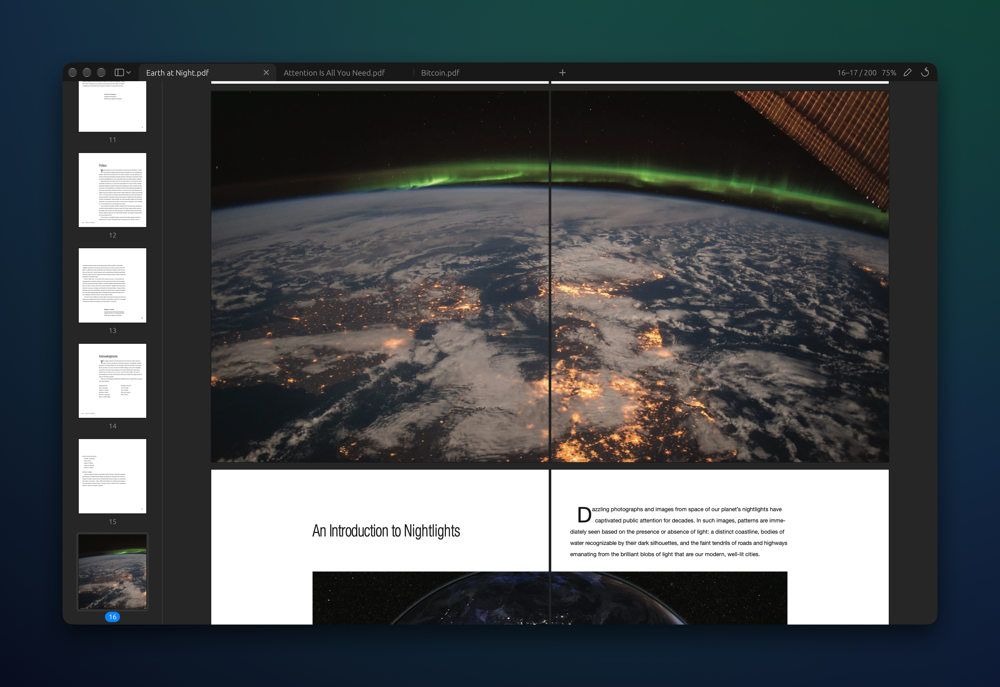

# Lightweight PDF

A small, fast PDF viewer for macOS, with tabs.

Open as many PDFs as you like. Tabs you aren't looking at use almost no memory or CPU.



## Why

Most PDF apps are heavy. This one does one thing: shows PDFs, quickly and cheaply.

- **Tabs.** Keep a stack of PDFs open in one window.
- **Idle tabs cost almost nothing.** When you switch away from a tab, it keeps a small compressed snapshot of what was on screen and closes the document. Switching back shows the snapshot straight away while the pages redraw.
- **Visible windows stay readable.** Every window keeps its current rendered pages, including when another app has focus.
- **Light on memory.** Rendered pages share one fixed GPU budget across all tabs, and only the pages near the screen are rendered. Pages you have scrolled past are let go instead of piling up, so memory stays flat however long you read.
- **Light on CPU.** Nothing redraws unless something changes. Pages are drawn with macOS's built-in PDF engine, the same one Preview uses.
- **Native.** Real macOS menu bar, Finder "Open With", drag and drop.

## Install

You need [Rust](https://rustup.rs) and the Xcode Command Line Tools (`xcode-select --install`).

```sh
git clone https://github.com/Dappner/lightweight-pdf-viewer.git
cd lightweight-pdf-viewer
./scripts/bundle.sh --install
```

This builds `Lightweight PDF.app` and puts it in `~/Applications`. PDFs then show it under **Open With** in Finder. To make it your default PDF app, choose a PDF, open **Get Info**, pick Lightweight PDF under **Open with**, and click **Change All**.

Or run it straight from source:

```sh
cargo run --release -- some.pdf another.pdf
```

## Using it

Open PDFs with ⌘O, by dragging them onto the window, or from Finder. Drag the sidebar's edge to resize it.

Drag a tab onto another window's tab strip to move it there. Dropping it away from an existing strip opens a new window; a window's last tab closes its source window when moved into another one.

The app reopens the windows and tabs you had open last time, including whether each window's sidebar was open or collapsed. Settings live in `~/Library/Application Support/Lightweight PDF/config.json`; set `"restore_tabs": false` there to start empty instead.

`"memory"` trades memory for speed. It takes effect the next time the app starts:

| Setting | Keeps | Good for |
| --- | --- | --- |
| `"low"` | Only what's on screen. Flipping back to a tab shows its snapshot for a moment while it redraws. | Macs short on memory |
| `"balanced"` (default) | A few screens of pages, and the last tab for a few seconds after you leave it. | Most people |
| `"fast"` | More rendered pages, more of each document parsed, and pages drawn three at a time. Uses several times the memory. | Plenty of free memory |

Searching a document saves its text in `~/Library/Caches/Lightweight PDF/Search/`, so the next search of it, even after a relaunch, skips reading the PDF's text again. A textbook takes 2–5 MB. `"search_cache": { "max_mb": 256, "max_days": 30 }` sets how much is kept: documents not searched for `max_days` are deleted, and the least recently searched go first once the folder is over `max_mb`. `"max_mb": 0` turns it off. Edit → Clear Search Cache deletes it all.

| Shortcut | Action |
| --- | --- |
| ⌘O | Open |
| ⌘K | Open a recent file (type to filter; most-used and latest first) |
| ⌘W | Close tab |
| ⌘P | Print, with highlights and text boxes not yet saved |
| ⌘1 … ⌘9 | Go to tab (⌘9 is the last tab) |
| ⌘⇧[ / ⌘⇧] or ⌃⇧Tab / ⌃Tab | Previous / next tab |
| ⌘B | Show or hide page thumbnails |
| ⌘= / ⌘- | Zoom in / out |
| ⌘0 | Fit page width |
| ⌘F | Find text (Enter / ⇧Enter or ⌘G / ⌘⇧G for next / previous match, Esc to close) |
| Space / ⇧Space | Page down / up |
| ⌘↑ / ⌘↓ | First / last page |

## Benchmark

A headless benchmark opens real PDFs through the app and reports speed and memory:

```sh
cargo bench --bench session -- a.pdf b.pdf
```

Set `BENCH_MEMORY=low|balanced|fast` to pick the memory setting and `BENCH_PPP=2` for Retina. It takes about 30 seconds, plus the search phase: a search in every tab, which fails if a tab you've left keeps its search's text after a few seconds (another 10–40 seconds, depending on how long the books take to read). `BENCH_FULL=1` runs each scenario more times and scrolls the whole last document (about 2.5 minutes).

Text search has its own, which searches each PDF end to end and fails if memory goes over budget or isn't given back when the search closes (a few seconds to half a minute per file):

```sh
cargo bench --bench search -- a.pdf b.pdf
```

`cargo bench --bench search_spike` measures PDFKit itself (text extraction, highlight geometry, contention with rendering), which the search design is based on.

`cargo bench --bench render_spike` measures CoreGraphics' rendering options the same way. [docs/performance.md](docs/performance.md) records what has been tried to make rendering faster and lighter, and what it measured.

## Requirements

macOS 11 or later. It uses macOS's own PDF engine, so it runs on macOS only. Elsewhere the crate still builds with a stand-in engine, so the portable core can be tested and benchmarked.

## Contributing

Issues and pull requests are welcome; see [CONTRIBUTING.md](CONTRIBUTING.md).

## License

MIT; see [LICENSE](LICENSE). `src/case_folding.rs` is generated from Unicode's CaseFolding.txt, under the [Unicode License v3](https://www.unicode.org/license.txt).
